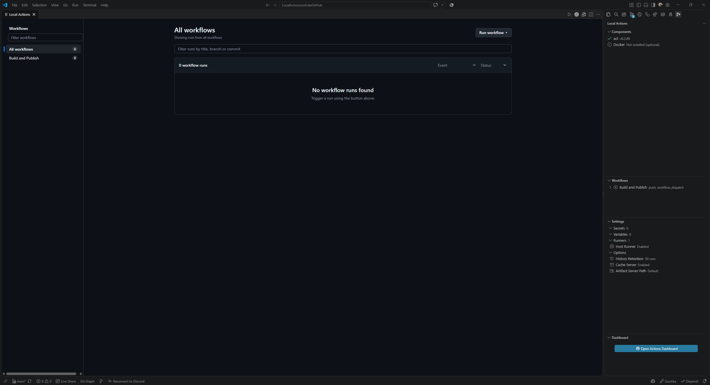
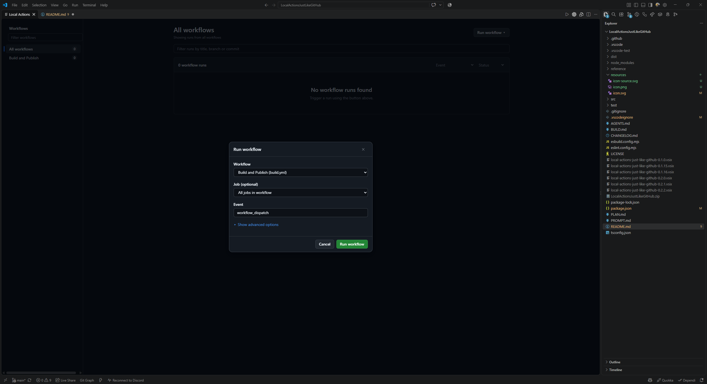
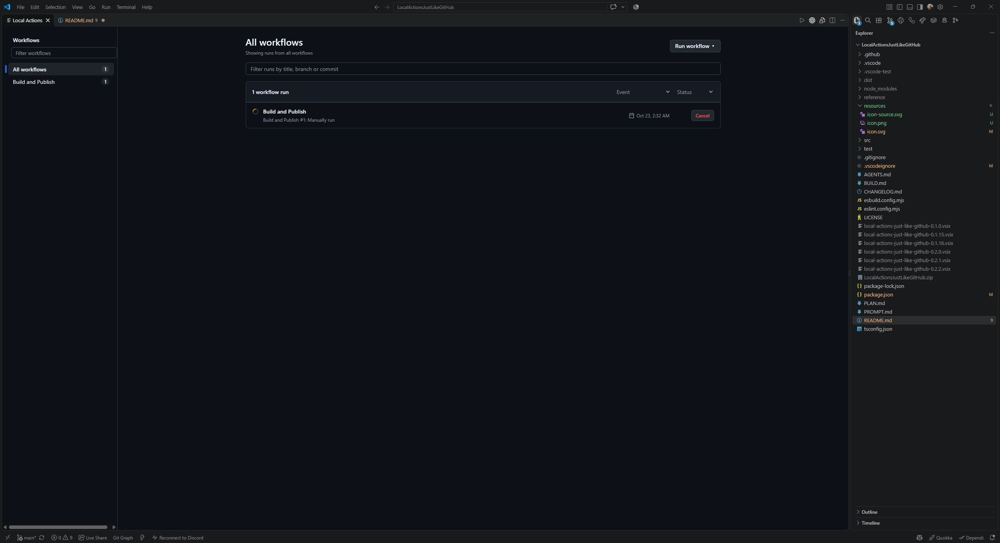
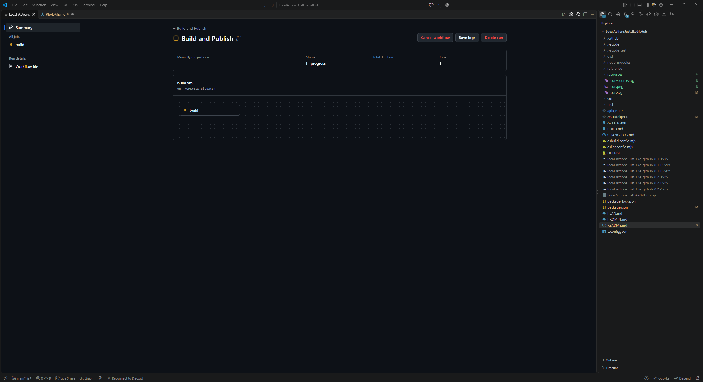
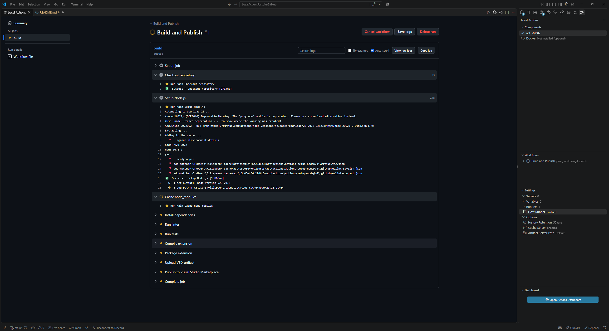
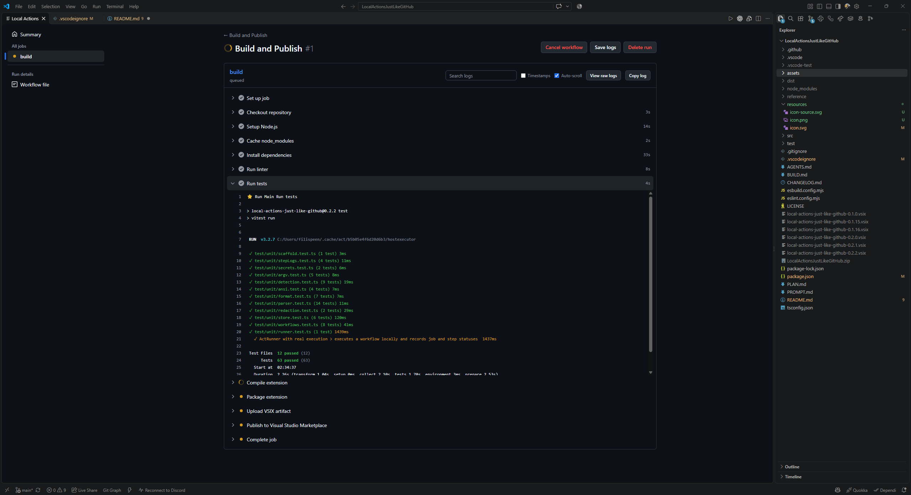

# Local Actions, Just Like In GitHub

Run GitHub Actions workflows locally through the `nektos/act` CLI with a page that looks and behaves just like GitHub Actions inside VS Code.

## Features

- **Actions Page Webview**: A complete GitHub Actions tab interface with:
  - **Left Sidebar**: View all workflows or filter by specific workflow files.
  - **Run List**: Rows with live status icons, run names, events, branches, duration, and relative time.
  - **Filters**: Instant filtering by search query, event type, and execution status.
  - **Run Detail View**:
    - Summary with trigger type, status, and duration.
    - Interactive **Job Dependency Graph** showing DAG relationships derived from `needs`.
    - Collapsible per-job steps with execution timing.
    - Rich log viewer with ANSI terminal colors, log search, copy button, and auto-scroll.
  - **Run Workflow Dialog**:
    - Automatically builds input forms from `workflow_dispatch` definitions.
    - JSON event payload editor with syntax validation.
    - Host runner and container platform overrides.
- **Components View**: Inspects system environment and reports availability of `act` and Docker.
- **Workflows View**: Live tree explorer of `.github/workflows` with actions to open files or trigger runs.
- **Settings View & SecretStorage**: Manage secrets securely via VS Code SecretStorage (OS keychain). Configure environment variables, runner images, and cache settings.
- **Clean Process Management**: Robust child process execution with full process tree termination on Windows and POSIX.

## Requirements & Compatibility

- **Node.js**: v20+
- **nektos/act CLI**: Required for local workflow execution. Tested against **act v0.2.89**.
- **Docker Engine**: Optional. Host runners run directly on your machine without Docker. Docker is only required for containerized environments.

## Preview

### Actions Dashboard & Local Sidebar

View workflows, trigger runs, and inspect environment components and settings directly in VS Code.

### Run Workflow with Custom Inputs

Configure workflows, select specific jobs, customize dispatch inputs, and override runner settings before launching.

### Live Workflow Runs

Track live execution status, trigger details, elapsed duration, and control active jobs in real time.

### Run Summary & Job Dependency Graph

Inspect the run overview, execution metadata, and interactive job dependency graph (DAG) derived from `needs`.

### Step-by-Step Log Streaming

Monitor workflow execution step by step in exact declared sequence with numbered log lines and duration tracking.

### Colored Terminal Output & ANSI Logs

Full ANSI color support, log search, timestamp toggles, and seamless switching between step logs and raw logs.

## Extension Settings

| Setting | Type | Default | Description |
|---|---|---|---|
| `localActions.actPath` | `string` | `"act"` | Path to the `act` CLI executable |
| `localActions.useHostRunner` | `boolean` | `true` | Run jobs directly on the host system without requiring Docker |
| `localActions.historyRetention` | `number` | `50` | Maximum number of workflow runs to retain in local storage |
| `localActions.variables` | `object` | `{}` | Environment variables passed to actions via `--var` |
| `localActions.defaultInputs` | `object` | `{}` | Default action inputs passed via `--input` |
| `localActions.runners` | `object` | `{}` | Custom image mappings per platform (e.g. `ubuntu-latest: catthehacker/ubuntu:act-latest`) |
| `localActions.noCacheServer` | `boolean` | `false` | Disable act cache server |
| `localActions.artifactServerPath` | `string` | `""` | Directory where act stores uploaded/downloaded artifacts |
| `localActions.extraArgs` | `array` | `[]` | Additional flags passed directly to `act` |

## Getting Started

1. Open a workspace folder containing GitHub Actions in `.github/workflows`.
2. Open the **Local Actions** activity bar icon.
3. Open the **Actions Page** via the Command Palette (`Ctrl+Shift+P` / `Cmd+Shift+P` -> `Local Actions: Open Actions Page`) or from the tree view title bar.
4. Click **Run workflow** to trigger workflows with custom inputs or parameters.

## License

Apache-2.0
